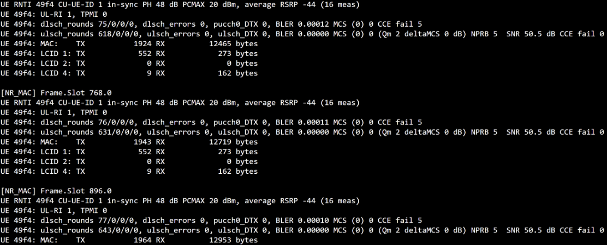
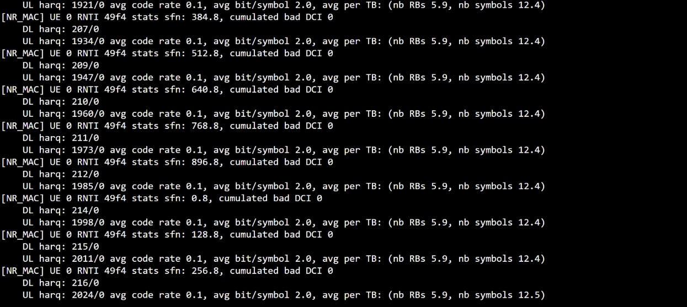
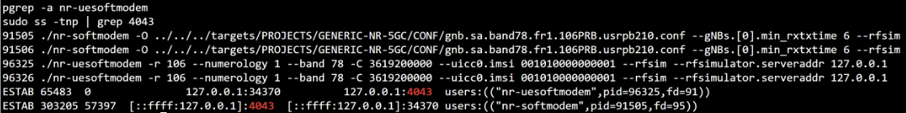
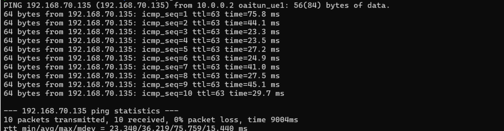
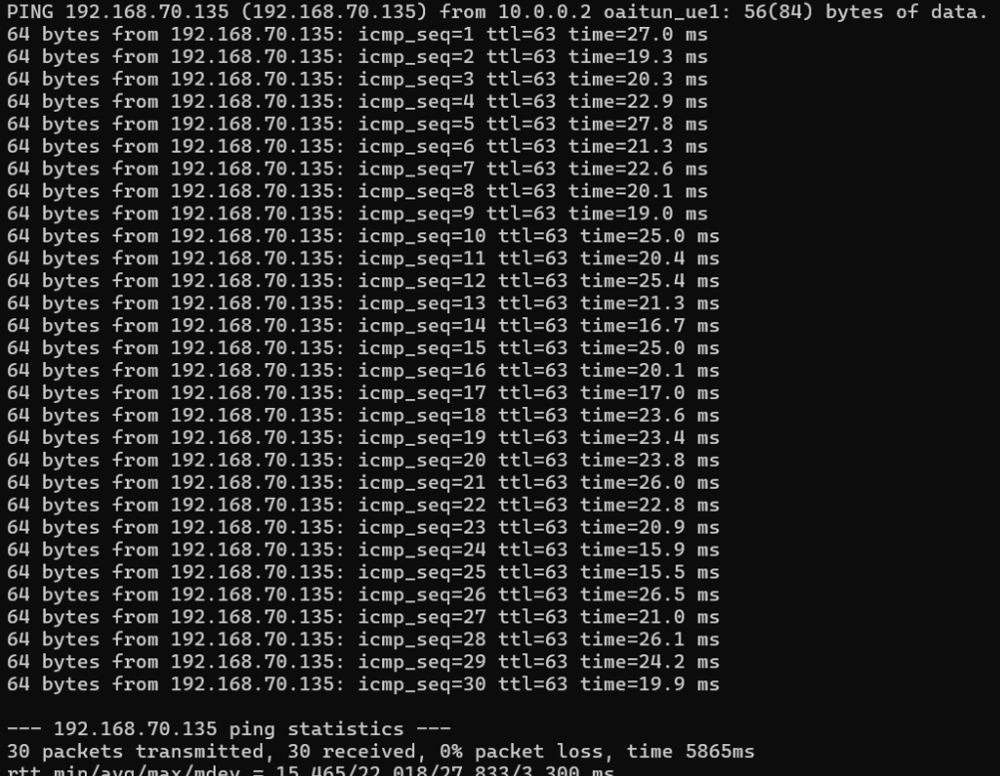
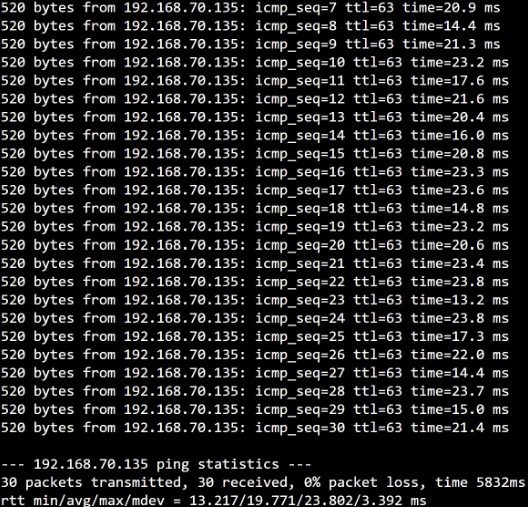
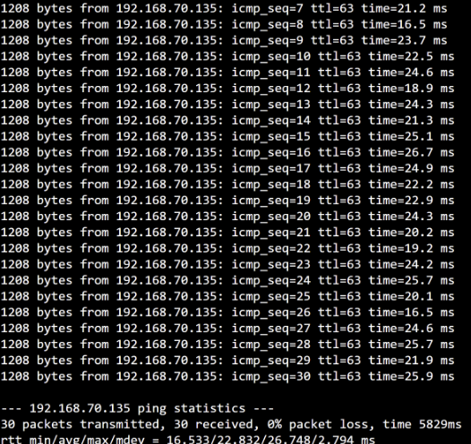

# Lab 3: Deploying a 5G Standalone Network Using OpenAirInterface

## 1. Goal
In the previous labs, you analyzed 5G signaling messages and network performance using provided captures and measurements.

In this lab, you will deploy your own 5G Standalone (SA) network using OpenAirInterface (OAI), verify the complete connection, investigate RFsimulator communication, perform active network measurements, and troubleshoot a controlled connection failure.

Unlike the previous labs, you will collect measurements directly from your own running 5G network.

**Learning Objectives**

After completing this lab, you should be able to:

1. Deploy an OAI gNB, nrUE, and 5G Core Network.
2. Identify the main stages of 5G SA connection establishment.
3. Verify communication between gNB and nrUE through RFsimulator.
4. Measure user-plane connectivity under different packet sizes.
5. Diagnose connection failures using OAI and 5GC logs.
6. Explain the limitations of a software-simulated 5G network.

## 2. Experimental Environment

Use the *OAI v2.4.0 Build Guide* to prepare the environment before class.

| Component | Configuration |
|---|---|
| Ubuntu | 24.04 |
| OAI RAN | v2.4.0 |
| 5G Core | OAI CN5G |
| gNB | nr-softmodem |
| UE | nr-uesoftmodem |
| Radio interface | RFsimulator |
| Band | n78 |
| Subcarrier spacing | 30 kHz |
| Resource blocks | 106 |
| UE IMSI | 001010000000001 |
| External DN | 192.168.70.135 |

The experiment uses one Ubuntu machine without physical RF hardware.

## 3. Task 1 — Deploy and Verify the Complete 5G SA Network

Start the OAI CN5G:

```bash
cd ~/oai-cn5g
docker compose up -d
docker compose ps
```

Start the gNB and nrUE using the commands in the Build Guide.

Observe their terminal outputs and locate evidence of the following stages.

| Stage | Successful? | Evidence from logs |
|---|---|---|
| CN5G initialization | Yes | show `healthy` |
| gNB NG Setup | Yes | gNB logs indicated successful SCTP connection and NG Setup with AMF |
| UE synchronization | Yes | `UE synchronized!` |
| RRC connection establishment | Yes | UE logs showed continuous data transmission (MAC TX/RX statistics) |
| UE Registration | Yes | Successful data flow and tunnel creation implied successful registration |
| PDU Session Establishment | Yes | `PDU Session Establishment Accept, UE IPv4: 10.0.0.2`|
| UE tunnel creation | Yes | `oaitun_ue1` interface was created with IP address `10.0.0.2` |

Take screenshots showing the gNB and UE successfully connected.


**Questions:**

1. Does a successful NG Setup guarantee that a UE can register? Explain.

   No.A successful NG Setup only establishes the control-plane connection (N2 interface over SCTP/NGAP) between the gNB (RAN) and the AMF (5G Core), verifying that they share compatible configurations (such as PLMNs and Tracking Area Codes). It does not guarantee UE registration because registration is a separate, UE-specific Non-Access Stratum (NAS) procedure that depends on the UE successfully synchronizing over the radio interface, establishing an RRC connection, and passing core network authentication and subscription checks
   
3. Why can the UE establish an RRC connection but still fail Registration?

   RRC connection establishment is strictly an Access Stratum (AS) procedure between the UE and the gNB over the air interface (Uu) to set up signaling radio bearers. Once the RRC connection is up, the UE encapsulates a Non-Access Stratum (NAS) Registration Request inside an RRC message, which the gNB forwards to the AMF. Registration can still fail at the core network level due to authentication failures, Unknown or unprovisioned subscriber or policy or Slice rejections.
   
5. What additional procedure is required after Registration before user data can be exchanged?

 PDU Session Establishment is required. While Registration authenticates the UE and attaches it to the 5G Core control plane (AMF), it does not allocate an IP address or create a user-plane data path. During PDU Session Establishment, the Session Management Function (SMF) and User Plane Function (UPF) allocate an IP address to the UE and set up the GTP-U tunnels (N3 interface between gNB and UPF) and Data Radio Bearers (DRBs) needed to route user-plane traffic to the external Data Network (DN).
   

## 4. Task 2 — Investigate RFsimulator Communication

OAI RFsimulator replaces the physical RF interface with software-based communication.

The gNB and nrUE exchange IQ samples through a TCP connection.

Check the running processes:

```bash
pgrep -a nr-softmodem
pgrep -a nr-uesoftmodem
```

Inspect the TCP connections:

```bash
sudo ss -tnp | grep 4043
```

If necessary, inspect the listener:

```bash
sudo ss -ltnp | grep 4043
```

The default RFsimulator port in this experiment is 4043.

Complete the table:

| Item | Observed Value |
|---|---|
| gNB process ID | **91505** (and 91506) |
| nrUE process ID | **96325** (and 96326) |
| RFsimulator transport protocol | **TCP** |
| RFsimulator port | **4043** |
| TCP connection state | **ESTAB** |
| Connected process(es) | `nr-softmodem` and `nr-uesoftmodem` |

Take one screenshot showing the TCP connection.

**Questions:**

1. Why does RFsimulator use a TCP connection instead of a physical antenna?
   
   RFsimulator replaces expensive, specialized radio hardware (such as USRPs, antennas, RF cables, and attenuators) with a software-defined virtual radio channel. Using a TCP socket allows the gNB (nr-softmodem) and nrUE (nr-uesoftmodem) to run on a single host machine or across containers without over-the-air transmissions, avoiding spectrum licensing issues, hardware setup complexity, and physical interference while ensuring reliable, lossless delivery of baseband signals during testing.
2. Are the TCP packets exchanged by RFsimulator the same as the UE's application-layer IP packets?

   No. The TCP packets on port 4043 carry raw baseband IQ (In-phase and Quadrature) time-domain samples representing the simulated radio waveform, not the UE's user-plane IP traffic. While the UE's application-layer IP packets (such as ICMP pings sent over oaitun_ue1) are encapsulated within that transmission, they pass down through the entire 5G protocol stack (SDAP, PDCP, RLC, MAC, and PHY) where they are encrypted, segmented, channel-coded, modulated, and converted into baseband IQ samples before being sent over the RFsimulator TCP link.
3. Does using RFsimulator mean that the UE and gNB are performing no physical-layer processing? Explain.
   
   No. Both the UE and gNB still execute the full 5G NR Physical Layer (Layer 1) signal processing chain in software. This includes CRC attachment, LDPC/Polar channel coding, scrambling, QAM modulation, MIMO layer mapping, resource grid mapping, and OFDM modulation/demodulation (IFFT/FFT). RFsimulator only bypasses the RF front-end (digital-to-analog/analog-to-digital conversion, frequency upconversion/downconversion, and physical antenna radiation), passing the resulting digital baseband IQ samples directly between the two PHY layers over TCP.
## 5. Task 3 — Verify End-to-End Connectivity

Check the UE tunnel interface:

```bash
ip -4 addr show oaitun_ue1
```

Test connectivity to the External DN:

```bash
ping -I oaitun_ue1 -c 10 192.168.70.135
```

Record:

| Measurement | Observed Value |
|---|---:|
| UE IP address | 10.0.0.2 |
| Destination IP | 192.168.70.135 |
| Packets transmitted | 10 |
| Packets received | 10 |
| Packet loss (%) | 0% |
| Minimum RTT (ms) | 23.340 |
| Average RTT (ms) | 36.219 |
| Maximum RTT (ms) | 75.759 |

Take a screenshot of the Ping result.

**Questions:**

1. Why must Ping use the `oaitun_ue1` interface in this experiment?

   oaitun_ue1 is the virtual TUN network interface created by the OpenAirInterface nrUE (nr-uesoftmodem) and assigned the UE's 5G Core IP address (10.0.0.2). Binding ping to oaitun_ue1 forces the ICMP traffic to enter the 5G UE protocol stack (SDAP, PDCP, RLC, MAC, PHY), traverse the simulated radio interface (RFsimulator) to the gNB, and pass through the 5G Core UPF (GTP-U tunnel over N3) to reach the External Data Network (192.168.70.135). Without specifying -I oaitun_ue1, the Linux host OS would route the ping directly through its standard host/Docker bridge network interface, completely bypassing the simulated 5G RAN and Core.
2. Does successful Registration guarantee successful user-plane connectivity?

   No. Registration is strictly a control-plane procedure with the AMF that authenticates the UE and attaches it to the network, without allocating an IP address or setting up data paths. User-plane connectivity requires a separate PDU Session Establishment procedure to succeed—where the SMF allocates the UE IP address (10.0.0.2), configures the UPF routing rules/NAT, and establishes both the Data Radio Bearers (DRBs) over the air and the N3 GTP-U tunnel between the gNB and UPF. If PDU Session Establishment, IP routing, or UPF forwarding fails, user-plane traffic will fail even though the UE is registered.
3. What does a successful Ping prove, and what does it not prove about the simulated 5G system?

    What it proves: It verifies end-to-end bidirectional IP connectivity across the full 5G stack—confirming that RRC connection, NAS Registration, PDU Session Establishment, IP address allocation (10.0.0.2), baseband signal processing over RFsimulator, gNB-to-UPF GTP-U encapsulation, and External DN routing are all functioning properly for basic control and low-rate data traffic.

What it does not prove: It does not prove real-world RF performance (such as resilience to multipath fading, interference, path loss, or Doppler shift, since RFsimulator uses a lossless TCP channel), high-throughput capacity, strict QoS/low-latency guarantees under heavy load, multi-UE scheduling fairness, or mobility/handover stability across multiple gNBs.
   

## 6. Task 4 — Investigate the Effect of Packet Size

You will now investigate whether changing the ICMP packet size affects the observed RTT.

Perform three experiments using the same established 5G connection.

**Scenario A — Small Packets**

```bash
ping -I oaitun_ue1 -s 56 -c 30 -i 0.2 192.168.70.135
```

**Scenario B — Medium Packets**

```bash
ping -I oaitun_ue1 -s 512 -c 30 -i 0.2 192.168.70.135
```

**Scenario C — Large Packets**

```bash
ping -I oaitun_ue1 -s 1200 -c 30 -i 0.2 192.168.70.135
```

Note: `-s` specifies ICMP payload size, not the complete IP packet size.



Complete the table:

| Scenario | ICMP Payload | Avg. RTT (ms) | Max. RTT (ms) | Packet Loss (%) |
| -------- | -----------: | ------------: | ------------: | --------------: |
| A        |     56 bytes |        22.018 |        27.833 |              0% |
| B | 512 bytes | 19.771 | 23.802 | 0% |
| C | 1200 bytes | 22.832 | 26.748 | 0% |
Calculate the RTT difference:

```text
*RTT Difference = Average RTT(C) - Average RTT(A) = 26.748 - 22.018 = **4.730 ms***
```

**Questions:**

1. Which scenario has the highest average RTT?
   Scenario C (1200 bytes) had the highest average RTT (**22.832 ms**).
2. Does increasing packet size always increase RTT in your measurements?
   Yes
3. Why might a larger packet require more transmission or processing resources?
    Becasue larger packets contains more data and needs more resources to process and transport. They require more schedulings, encoding, decoding and memory.
4. What factors other than packet size could affect RTT in a software-based 5G network?
   
   5G NR Frame Structure & Scheduling: Subcarrier spacing (e.g., 15 kHz vs. 30 kHz, which determines slot duration: 1 ms vs. 0.5 ms), TDD downlink/uplink slot patterns (waiting for an uplink slot to send the ICMP echo request or reply), and Scheduling Request (SR) / Buffer Status Report (BSR) periodicity.

Host CPU Load & Thread Scheduling: OAI nr-softmodem and nr-uesoftmodem are real-time, CPU-intensive DSP applications. Host background processes, CPU frequency scaling, core pinning, or virtualization overhead directly delay slot processing.

RFsimulator TCP Buffering: Socket buffer sizes, Nagle's algorithm/TCP delays, and inter-process communication overhead between the UE and gNB processes.

Core Network & Routing Overhead: Packet traversal through the TUN interface (oaitun_ue1), GTP-U encapsulation/decapsulation at the gNB and UPF, and Docker bridge routing delays.

5. Can these results be interpreted as real over-the-air 5G latency? Explain.
No. While the testbed accurately executes the 5G NR protocol stack (RRC, SDAP, PDCP, RLC, MAC, and baseband PHY) and reflects realistic protocol-level scheduling delays (such as TDD slot alignment and SR/BSR handshakes), the measured RTT does not represent commercial over-the-air 5G latency.
Do not assume that RTT must increase with packet size. Use your measured values to support your explanation.

## 7. Task 5 — Diagnose a Controlled UE Registration Failure

In this task, you will deliberately introduce one configuration error and investigate why the UE cannot complete registration.

**Important:** Save the original successful UE command before starting. Do not modify the CN5G subscriber database.

### Step 1 — Stop the UE

Press `Ctrl+C` in the nrUE terminal. Keep the CN5G and gNB running.

### Step 2 — Launch the UE with an Incorrect IMSI

Change only the IMSI:

```bash
sudo ./nr-uesoftmodem \
  -r 106 \
  --numerology 1 \
  --band 78 \
  -C 3619200000 \
  --uicc0.imsi 001010000000099 \
  --rfsim \
  --rfsimulator.serveraddr 127.0.0.1
```

The IMSI `001010000000099` is not provisioned in the standard classroom subscriber configuration. Verify this assumption against the instructor's database before class.

Observe the UE and AMF logs.

```bash
cd ~/oai-cn5g
docker compose logs --since=2m oai-amf
```

Allow time for registration attempts, then stop the UE.

Complete the table:

| Item | Observation |
|---|---|
| Modified parameter | |
| UE synchronized with gNB? | |
| RRC connection established? | |
| Registration successful? | |
| Error or rejection evidence | |
| Likely cause | |

If the expected registration rejection does not appear, report the actual logs instead of inventing a failure message.

### Step 3 — Restore the Original IMSI

Restart the nrUE using:

```text
--uicc0.imsi 001010000000001
```

Confirm that the UE successfully registers again and that Ping works.

**Questions:**

1. Why can the UE potentially synchronize with the gNB even when the IMSI is incorrect?
2. Which network function is involved in UE authentication?
3. Why does changing an IMSI affect Registration but not the RFsimulator TCP connection itself?
4. What evidence proves that restoring the correct configuration solved the problem?

Submit evidence from both the failed and recovered connections.


## 8. Task 7 — Explain the Relationship Between Simulation and Real 5G

Your OAI gNB and nrUE perform 5G NR protocol processing even though they do not use physical antennas.

Complete the comparison:

| Feature | OAI RFsimulator | Physical 5G System |
|---|---|---|
| gNB and UE protocol stack | | |
| OFDM signal processing | | |
| Physical antennas | | |
| RF hardware impairments | | |
| Wireless propagation effects | | |
| 5G Core connectivity | | |

**Questions:**

1. Which parts of the 5G system remain functional when physical RF hardware is replaced with RFsimulator?
2. Why is RFsimulator useful for testing the 5G protocol stack?
3. Why might latency and throughput differ between RFsimulator and a real 5G deployment?
4. What would need to change if you wanted to test a physical UE instead of OAI nrUE?

## 9. Final Analysis

Answer each question in three to five sentences.

1. Describe the complete process from starting the OAI 5GC to successful user-plane connectivity.
2. Explain the difference between an RFsimulator TCP connection and a 5G PDU Session.
3. Based on your measurements, how did packet size affect RTT and packet loss?
4. Describe the registration failure you introduced and explain how you diagnosed and recovered from it.
5. Identify two limitations of this simulated environment and explain how they might affect experimental results.

## 10. Submission Checklist

Submit one Markdown or PDF report containing:

- Completed 5G SA connection verification table.
- gNB and nrUE connection screenshots.
- RFsimulator TCP connection evidence.
- Baseline Ping measurement.
- Three packet-size comparison results.
- RTT difference calculation.
- Controlled failure and recovery evidence.
- RFsimulator versus physical 5G comparison.
- Answers to the final analysis questions.

All measurements and log evidence must come from your own experimental environment.

## 11. Grading Rubric

| Item | Points |
|---|---:|
| Complete 5G SA deployment | 15 |
| RFsimulator TCP connection analysis | 15 |
| End-to-end user-plane verification | 15 |
| Packet-size experiment and analysis | 20 |
| Controlled failure and recovery | 20 |
| Simulation limitations and final analysis | 15 |
| **Total** | **100** |
